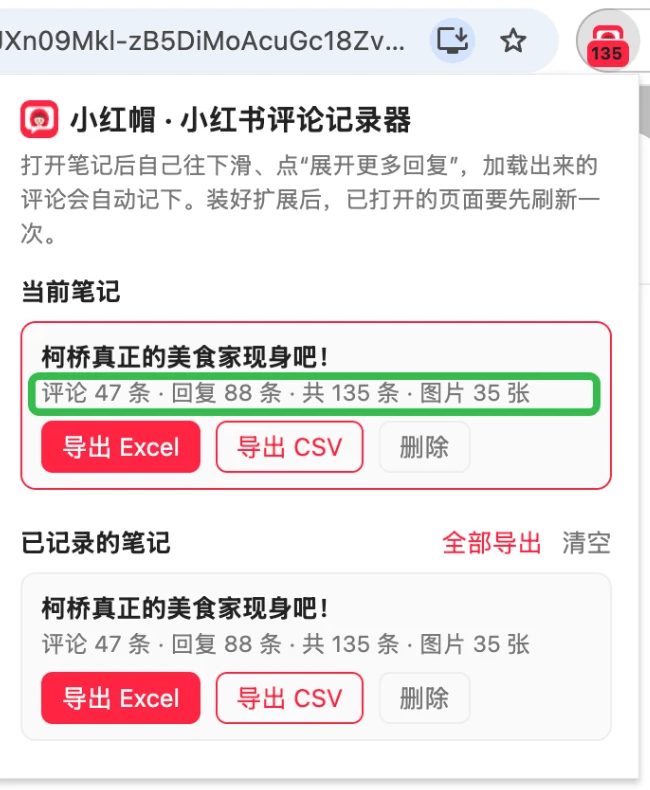
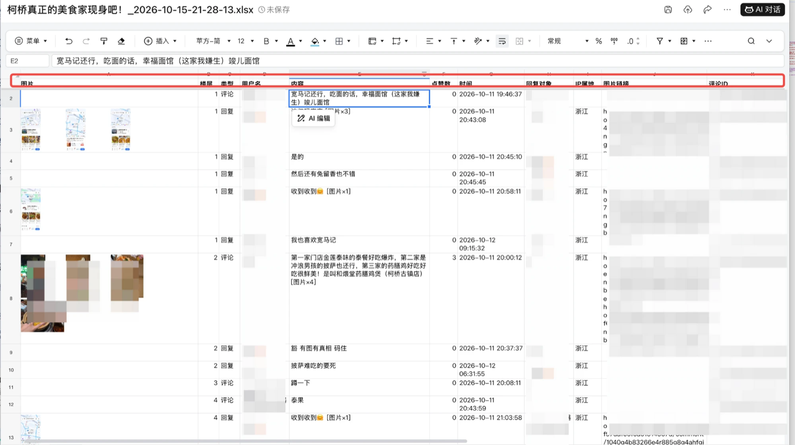

<p align="center"></p>

# 小红帽 · 小红书评论记录器

一个 Chrome 扩展。你照常在浏览器里看小红书笔记，它会在旁边把**页面已经加载出来的评论和楼中楼回复**记下来，看完点一下就能导出成 **Excel（评论图片直接显示在对应评论那一行）** 或 CSV。

## 效果预览

<table>
<tr>
<td width="38%" valign="top"></td>
<td valign="top"></td>
</tr>
<tr>
<td valign="top">滑完评论区后点开插件：工具栏图标上的数字是已记录的条数，弹窗里能看到评论、回复和图片各有多少。</td>
<td valign="top">导出的 Excel：评论图片放在第一列，和对应的评论在同一行；回复紧跟在所属评论下面，楼层号相同。（截图中的用户名已打码）</td>
</tr>
</table>

实测：一篇显示“140 条评论”的笔记，滑到底并展开全部回复后，记录到 135 条（一级评论 47 条 + 回复 88 条），含 35 张评论图片。少的几条一般是已删除或被折叠的评论。

## 使用前提

这个插件**只负责记录，不替你操作**。使用时需要满足这几个前提：

1. 在自己平时用的 Chrome 里，登录小红书网页版（www.xiaohongshu.com）。
2. **亲手**打开笔记、往下滑评论区、点击“展开 N 条回复”。插件不会自动滚动或点击。
3. 你看到哪些评论，插件就记下哪些。没滑到、没展开的评论不会被记录。
4. 看完后，**点开浏览器右上角的插件图标**，手动导出。

## 适合什么情况

**适合：** 对少量笔记做细致整理。比如收集一篇攻略帖下的推荐清单、整理产品反馈、做课程作业或研究里的案例分析。

**不适合：** 批量采集大量笔记、长期监控、定时自动抓取。这些需求请使用小红书官方的数据服务（蒲公英、聚光等），或者有授权的第三方数据平台。

### 按评论区规模看

小红书网页版每往下滑一次，大约加载 10 条一级评论；每点一次“展开回复”，大约加载 10 条回复。笔记上显示的“共 N 条评论”一般**包含回复**。

| 评论总数 | 适合程度 | 需要的手动操作 | 建议 |
|---|---|---|---|
| 300 条以内 | ✅ 最适合 | 滑动几十次，展开回复若干次 | 一次看完、一次导出 |
| 300–1000 条 | 👌 可以 | 滑动和展开的次数明显增多 | 分 2–3 次看完，中间休息；记录会自动合并、去重 |
| 1000–3000 条 | ⚠️ 勉强可以，比较费力 | 需要大量滑动和点击 | 分多天完成；只展开你关心的回复 |
| 3000 条以上 | ❌ 不建议 | 手动操作量太大 | 改用官方或授权数据平台 |

导出带图片的 Excel 时，图片越多，等待越久（大约几十张图需要几秒到十几秒）。导出期间不要关闭弹窗。

## 关于风控

**插件降低风控风险的方式：**

- **不发出任何额外请求。** 插件只“旁听”小红书网页自己发出的评论请求的返回结果，不改动请求，也不会自己去请求小红书服务器。
- **不自动滚动、不自动点击。** 浏览、滚动、展开回复都由你本人完成，平台看到的就是一个正常用户在浏览。被风控的常见原因是自动化工具留下的“程序在操作”痕迹，以及机械、过快的操作节奏，这两点插件都不会产生。
- 导出 Excel 时，插件会下载评论里的图片做缩略图。这和网页显示图片一样，请求的是图片服务器，不经过评论接口。
- 数据只保存在你电脑的浏览器里，不会上传到任何地方。

**插件无法替你避免的风险：**

风控看的是账号的整体行为。即使全部手动操作，短时间内连续浏览大量笔记、长时间不停地刷评论区，也可能被限流或要求验证。小红书没有公开具体的限制标准，下面是保守的建议，不是官方数据：

- 按正常阅读的速度浏览，不要连续快速地猛滑。
- 一次只处理少量笔记，大评论区分几次完成。
- 如果出现验证码、提示“操作频繁”，或者评论加载不出来，**立即停下来休息**，过几个小时再继续。

没有任何工具能保证完全不被风控，请合理使用。

## 导出的字段

| 列 | 说明 |
|---|---|
| 楼层 | 第几条一级评论，它下面的回复和它同一个楼层号 |
| 类型 | 评论 / 回复 |
| 用户名 | 发评论或回复的人 |
| 内容 | 文字内容，带图片的会标注 `[图片×N]` |
| 点赞数 | |
| 时间 | 年-月-日 时:分:秒 |
| 回复对象 | 这条回复是回给谁的 |
| IP属地 | |
| 图片链接 | 评论里附带的图片地址，多张时每行一个，复制到浏览器即可打开 |
| 评论ID / 所属一级评论ID | 方便去重和二次处理 |

Excel 的第一列是“图片”：评论图片缩成缩略图，放在对应评论的那一行，多张图时每行排 3 张。图片放在第一列，是因为 Excel、Numbers、在线表格换算列宽的方式各不相同，只有第一列的位置在所有软件里都一致。

已考虑的打开方式：Excel、WPS、Numbers，以及导入腾讯文档、飞书、Google 表格。

“全部导出”生成的是 CSV，前面会多出“笔记标题”和“笔记ID”两列。

## 安装（约 1 分钟）

1. 下载本项目：点页面上方绿色的 **Code → Download ZIP**，然后解压。
2. 在 Chrome 地址栏打开 `chrome://extensions`。
3. 打开右上角的 **开发者模式**。
4. 点 **加载已解压的扩展程序**，选择解压后的文件夹（里面有 `manifest.json` 的那一层）。
5. 点浏览器右上角的拼图图标，把“小红帽 · 小红书评论记录器”（红色图标、戴小红帽的小女孩）固定到工具栏，方便使用。

## 使用

1. 登录小红书网页版，打开一篇笔记。**如果安装扩展前就已经打开了页面，请先刷新。**
2. 在评论区往下滑，直到出现“- THE END -”；需要楼中楼时，手动点击每条评论下的“展开 N 条回复”。
3. 扩展图标上的红色数字会随着记录增加。
4. 点击扩展图标，在“当前笔记”里点 **导出 Excel**。有评论图片时，统计行里会显示图片数量，导出时请等进度走完再关闭弹窗。不需要图片时，点 **导出 CSV** 更快。

小技巧：

- 记录会一直保存。可以分几次看完同一篇笔记，数据会自动合并、去重。
- 小红书显示的“共 N 条评论”通常已经包含回复，可以和扩展里的“共 X 条”对照，看是否已经采集完整。少几条一般是被折叠或删除的评论。
- 不需要的记录可以在弹窗里单独删除，也可以全部清空。
- 图片链接可能过一段时间就失效，需要图片的话尽早导出 Excel。
- 图片服务器偶尔会超时，插件会自动重试（最多 3 次）。仍然失败的图片，会在“图片链接”列标上“【未能加载，请手动打开】”，弹窗也会告诉你在第几楼；可以手动打开链接，或者稍后再导出一次。
- 插件更新后，到 `chrome://extensions` 点插件卡片上的 ↻ 才会生效。如果弹窗提示记录“来自旧版本”，删除记录后刷新笔记页面，重新滑一遍评论区。
- 小红书的图片多是 webp 格式，Excel 不支持，导出时会自动转成 JPEG 缩略图。
- 在 Numbers 里第一列会显得比较宽，这是 Numbers 换算列宽的方式造成的，可以手动拖窄。

## 原理

```
小红书网页 ──请求评论接口──▶ 小红书服务器
     │  ◀──返回 JSON──────────┘
     │
inject.js（在页面中旁听 fetch/XHR，复制一份返回结果）
     │ postMessage
bridge.js（解析、去重，存进 chrome.storage.local）
     │
popup（查看统计，导出 CSV / 带图片的 Excel）
```

监听的接口：

- `/api/sns/web/v2/comment/page`：一级评论，每条会附带前几条回复
- `/api/sns/web/v2/comment/sub/page`：点击“展开回复”后加载的更多回复

如果小红书更换了接口路径或数据格式，需要修改 `lib/parse.js`。

## 开发

```bash
node test/parse.test.js
```

`test/popup-preview.html` 用示例数据预览弹窗样式。`test/export-preview.html` 用本地图片跑一遍 Excel 导出，可以下载生成的文件检查效果。

```bash
node test/xlsx.test.js 输出.xlsx 图片1.jpg 图片2.jpg
```

用指定的 JPEG 生成一个示例 Excel，检查文件结构。

`test/intercept.html` 用来在本地验证请求拦截：在项目根目录运行 `python3 -m http.server 8765`，然后打开 `http://localhost:8765/test/intercept.html`。

## 声明

本工具与小红书官方无关，图标为原创设计。本工具只用于个人学习、研究和整理自己能正常看到的公开内容。请遵守小红书用户协议和《个人信息保护法》等相关法律法规，不要用于大规模采集、商业转售或侵犯他人隐私。导出数据中包含其他用户的昵称和发言，分享前请做好处理。

## 许可证

[MIT](LICENSE)
